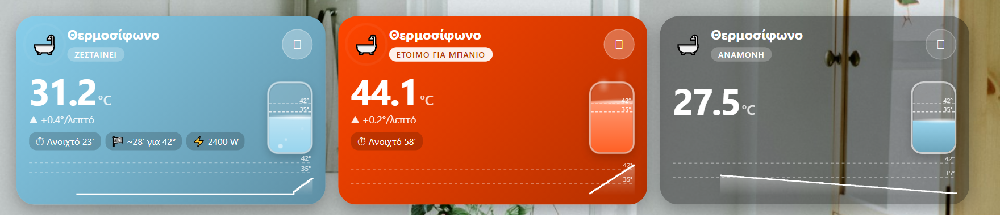

# Water Heater Card

Κάρτα **θερμοσίφωνα** για το Home Assistant. Το χρώμα αλλάζει με τη θερμοκρασία, και ένα **κινούμενο δοχείο νερού** γεμίζει ανάλογα, με φυσαλίδες όσο ζεσταίνει και ατμό όταν είναι καυτό. Δείχνει **ρυθμό ζεστάματος**, **πόσο απομένει** μέχρι το όριο, πόση ώρα είναι αναμμένο, ένδειξη «έτοιμο για μπάνιο» και **γράφημα** θερμοκρασίας.

*Water-heater card: temperature-coloured, animated water tank (bubbles while heating, steam when hot), heating rate, ETA to the "ready" temperature, time on, power and a temperature graph. Full visual editor.*



## Εγκατάσταση
**HACS:** ⋮ → Custom repositories → `https://github.com/stathisktm/water-heater-card`, τύπος **Dashboard** → Download.
**Χειροκίνητα:** αντέγραψε το `water-heater-card.js` στο `/config/www/` και πρόσθεσε πόρο `/local/water-heater-card.js` (JavaScript module).

## Ρύθμιση
Από τον **οπτικό editor**, με επιλογή οντοτήτων, εικονιδίου και θέματος, και χρώματα με επιλογέα, ή σε YAML:
```yaml
type: custom:water-heater-card
title: Θερμοσίφωνο
icon: mdi:bathtub-outline
entity_switch: switch.water_heater
entity_temp: sensor.water_heater_temperature
entity_power: sensor.water_heater_power   # προαιρετικό
temp_mid: 35
temp_high: 42        # πάνω από εδώ: «έτοιμο για μπάνιο»
temp_max: 60         # η κορυφή του δοχείου
color_low: "#87CEEB"
color_mid: "#FFA500"
color_high: "#FF4500"
theme: default
show_graph: true
graph_hours: 6
tap_toggle: true     # πάτημα = άναμμα/σβήσιμο (κράτημα = λεπτομέρειες)
```
Ο ρυθμός και ο χρόνος μέχρι το όριο βγαίνουν από τα τελευταία 15 λεπτά του ιστορικού του αισθητήρα.

## Αλλαγές
- **2.0.0:** κινούμενο δοχείο με όρια, φυσαλίδες και ατμό, ρυθμός °/λεπτό, χρόνος μέχρι το όριο, «Ανοιχτό Χ′», «έτοιμο για μπάνιο», γράφημα θερμοκρασίας, κατανάλωση, κουμπί power, κράτημα για λεπτομέρειες, νέος editor (ha-form με επιλογέα χρωμάτων), ομαλές μεταβάσεις χρωμάτων. Η αρχική έκδοση υπάρχει στο πρώτο commit.

## Άδεια
[MIT](LICENSE)
